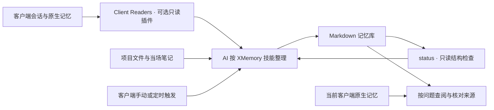

# XMemory

XMemory 是跨客户端的 Markdown 记忆库。AI 按技能把选定的会话、原生记忆、项目文件和当场笔记整理为可追溯的记录，再按需要更新日总结、项目总结、项目意识、用户画像与全局摘要。

它适合在多个 AI 客户端之间接续项目、回查决定与经验、保留长期偏好。记忆保存为普通文件，可直接阅读和编辑；客户端继续使用自己的原生记忆，XMemory 补充跨客户端信息。

| 组件 | 当前版本 | 职责 |
|---|---|---|
| [XMemory](plugins/xmemory/README.md) | **1.6.1** | 八个技能、对象格式与模板、只读 `status` |
| [Client Readers](plugins/client-readers/README.md) | **0.2.1** | 五端会话、原生记忆与项目候选读取，可独立安装 |
| 记忆文件格式 | `xmemory/v1.5` | 现有 1.5.x 库沿用原格式 |

[下载 v1.6.1](https://github.com/BlueSkyXN/XMemory/releases/tag/v1.6.1) · [文档导航](docs/README.md) · [安装与升级](docs/release-install.md) · [使用指南](plugins/xmemory/docs/usage.md) · [版本说明](docs/v1.6/README.md)

## 工作方式



AI 负责判断与写入；程序负责读取或检查。XMemory 的唯一程序命令是 `status`，Client Readers 提供 `projects`、`sessions`、`memory`、`doctor`。定时运行由宿主客户端调度。

Client Readers 可读取 Codex、Claude Code、ZCode、Qoder CN 和 WorkBuddy 的已适配本机数据。也可以只安装 XMemory，按[来源参考](plugins/xmemory/skills/xmemory/references/sources.md)读取选定文件。

## 开始使用

1. 从 [Releases](https://github.com/BlueSkyXN/XMemory/releases/tag/v1.6.1) 下载完整市场包或独立技能包，按[安装说明](docs/release-install.md)校验并安装。三个宿主市场统一使用 `xmemory-marketplace`；旧读取器升级需先移除 `conversation-readers`。
2. 告诉代理记忆根、时区、来源和项目。例如：**“设置 XMemory，先列出项目候选，我选择后再启用来源。”** 默认根为 `~/.agents/memory/`，来源默认关闭。
3. 按当前需要调用技能，完成后查看实际产物与检查结果。

| 想做的事 | 可以这样说 |
|---|---|
| 更新选定范围 | “更新记忆，只处理这个项目最近两天的会话。” |
| 接续工作 | “查一下这个项目上次的决定和未完成项，核对后来的更正。” |
| 保存当场决定 | “记住：这个项目的发布前检查必须包含回滚验证。” |
| 只更新一个对象 | “只根据现有记录更新这个项目的意识。” |
| 按日期回顾 | “查一下昨天各项目做了什么，给出来源。” |
| 遗忘会话 | “遗忘这个完整会话身份，并清理仅由它支撑的内容。” |

在源码仓库根目录，可以直接运行只读检查：

```bash
python3 -B plugins/xmemory/skills/xmemory/scripts/xmemory.py --root "/absolute/path/to/memory" status
```

插件安装后，使用实际安装目录中的 `skills/xmemory/scripts/xmemory.py`。根目录优先级为 `--root` → `XMEMORY_ROOT` → `~/.agents/memory/`。缺库或配置无效时退出 2，成功生成报告时退出 0；报告中的待处理项见[状态说明](plugins/xmemory/docs/usage.md#读懂-status)。

## 记忆中保存什么

| 对象 | 位置 | 主要回答 |
|---|---|---|
| 记录 | `records/` | 当时说了什么、做了什么、依据在哪里 |
| 日总结 | `daily/<年>/<日期>.md` | 某天各项目发生了什么变化 |
| 项目总结 | `projects/<项目>/MEMORY.md` 与 `topics/` | 哪些决定、方法、条件与经验值得复用 |
| 项目意识 | `projects/<项目>/AWARENESS.md` | 项目目前怎样、有什么冲突和未完成项 |
| 用户画像 | `USER.md` | 哪些长期偏好会影响后续协作 |
| 全局摘要 | `memory_summary.md` | 有哪些项目、接下来应去哪里查 |

日总结、项目总结、意识和画像按各自来源独立更新。全局摘要提供已有入口；无项目的个人内容使用 `personal/`，项目归属未定的材料保留未定标记。对象关系见[设计说明](plugins/xmemory/docs/design.md)，完整字段见[文件格式](plugins/xmemory/skills/xmemory/references/format.md)。

## 运行要求与范围

- 安装后的脚本需要 Python 3.9+。普通读取与 `status` 使用标准库；Codex `.jsonl.zst` 还需要已有的 zstd 后端，检查方法见 [Client Readers](plugins/client-readers/README.md#运行环境与自检)。
- 记忆库使用 Markdown 与 TOML，不依赖 Git、数据库或后台服务。模型由宿主客户端提供，Python 脚本本身不调用模型。
- `status` 检查库内字段、链接、时间和更新线索；外部来源是否读全、结论是否正确，由技能结合原件判断。
- 客户端原生记忆继续独立维护。联合查阅先应用 `exclude_sessions`；原生副本的物理删除按对应客户端机制处理。
- 多客户端写同一库时需要错开执行；当前版本不提供并发写协调或多机同步。

程序测试、模型行为评测、客户端安装与定时调度的结果分别记录在[验证报告](docs/validation.md)。

## 参与开发

开发工具需要 Python 3.11+。在仓库根运行：

```bash
python3 -B tools/check_package.py
python3 -B tools/build_client_readers.py --check
python3 -B -m unittest discover -s tests -v
python3 -B tools/build_release.py --output dist/docs-check
```

构建输出目录须选择尚无同名归档的位置。读取器维护源、五份分发副本、CI 与评测路径见[开发指南](docs/development.md)。构建只生成本地 ZIP 与校验文件，发布包不包含 `local/` 材料。

许可证：[GNU GPL v3](LICENSE)。
