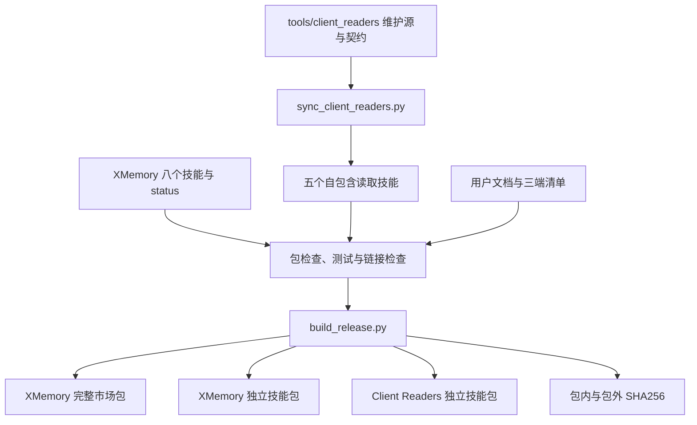

# 开发与验证指南

本指南面向修改 XMemory 与 Client Readers 的维护者。安装后的运行时支持 Python 3.9+；仓库检查和构建工具需要 Python 3.11+。下面命令均从仓库根运行。

## 源码与分发目录

| 位置 | 维护内容 |
|---|---|
| `plugins/xmemory/skills/` | 八个正式技能、模板、参考与只读 status |
| `plugins/xmemory/skills/xmemory/scripts/` | `xmemory.py` 入口、`status.py` 与配置解析器 |
| `tools/client_readers/` | 五端读取器公共维护源及两份输出契约 |
| `plugins/client-readers/skills/read-*/scripts/` | 同步生成的包装脚本与运行时副本 |
| `plugins/client-readers/skills/read-*/references/` | 每端布局说明，以及同步生成的公共输出契约 |
| `plugins/*/docs/` 与插件 README | 随完整插件分发的用户文档 |
| `docs/` | 仓库导航、版本、安装包说明与验证证据 |
| `tests/` | status、读取器、运行环境与包装回归 |
| `evals/` | 虚构材料、行为评测输入与判据 |
| `local/`、`dist/` | 被忽略的本机材料与构建输出 |

读取器公共逻辑只在 `tools/client_readers/` 修改。五份 Skill 中的 `references/sessions.md`、`references/memory.md` 是各端独有文档；`output-sessions.md`、`output-memory.md` 由公共契约生成。



各读取技能携带完整运行代码，可独立复制；不在运行时跨 Skill 导入。同步脚本只处理 Client Readers，不向 XMemory 嵌入读取器。

## 修改后的检查

只检查副本差异：

```bash
python3 -B tools/sync_client_readers.py
```

维护源或公共契约有改动后再执行同步：

```bash
python3 -B tools/sync_client_readers.py --apply
```

仓库的基本门禁：

```bash
python3 -B tools/check_package.py
python3 -B tools/build_client_readers.py --check
python3 -B -m unittest discover -s tests -v
```

前两项检查清单、版本、允许载荷、相对链接与自包含边界；读取器检查还核对五份副本。`sync` 默认只检查，发现差异退出非零；`--apply` 写入预期副本后再次核对。

需要缩小回归范围时使用对应测试模块：

| 改动 | 测试模块 |
|---|---|
| status、库内字段与链接判断 | `tests.test_xmemory_status` |
| 会话读取与引用 | `tests.test_client_readers` |
| 原生记忆与项目候选 | `tests.test_client_memory` |
| 解释器、zstd、自检和入口兼容 | `tests.test_client_runtime` |
| 清单、技能结构与打包 | `tests.test_package` |

运行时兼容检查使用现有 Python 3.9 解释器执行 `tests.test_xmemory_status tests.test_client_readers tests.test_client_memory tests.test_client_runtime`。本机缺少某解释器时记录未运行范围，不为文档检查引入新依赖。

## 构建与包内文档

选择尚无同名归档及校验文件的输出目录：

```bash
python3 -B tools/build_release.py --output dist/release-check
```

| 当前产物 | 内容与文档位置 |
|---|---|
| `XMemory-1.7.0.zip` | 三端市场与两个插件；`INSTALL.md`，以及各插件 README、docs、技能参考 |
| `XMemory-1.7.0-skills.zip` | XMemory `skills/`、`INSTALL.md`、许可证 |
| `ClientReaders-0.2.1-skills.zip` | 读取器 `skills/`、README、`docs/validation.md`、许可证 |

构建还生成各包外部 `.zip.sha256` 与内部 `SHA256SUMS`。归档文件名来自插件清单版本；写入 ZIP 使用固定时间与权限，便于比较相同载荷的构建结果。构建拒绝覆盖已有归档。

仅构建读取器时：

```bash
python3 -B tools/build_client_readers.py --output dist/readers-check
```

该命令生成读取器插件包与独立技能包；正式整套构建使用前面的 `build_release.py`，其三个产物与当前 Release 附件对应。所有构建命令只生成本地文件，不安装或发布。

修改文档时同时检查以下边界：

- 插件 README 和 docs 的相对链接保留在插件目录内；XMemory 技能间链接保留在同一 `skills/`，读取器每个技能的链接保留在该技能内。
- `docs/release-install.md` 会复制到两个 XMemory 包根作为 `INSTALL.md`；跨包参考使用稳定在线入口，避免依赖仓库相对路径。
- 读取器独立技能包只额外带 README 和 `docs/validation.md`；新建其他插件级文档前先核对构建载荷。
- 文档图使用 Markdown 内嵌 Mermaid，校验图语法、节点含义、方向及文字可读性；表格和正文提供阅读上下文。
- 公开文档与夹具使用虚构项目和占位路径，不带真实会话、凭据或个人资料。

## CI 与行为评测

当前 [Validate 工作流](../.github/workflows/validate.yml)包含四个独立任务：

| 环境 | 执行内容 |
|---|---|
| Ubuntu / Python 3.11 | 包检查、全套 unittest、整套与读取器归档构建 |
| Ubuntu / Python 3.9 | status、会话、原生记忆、运行环境四组测试 |
| Windows / Python 3.11 | 会话、原生记忆、运行环境三组测试 |
| Ubuntu / Python 3.11 + zstandard | 在 CI runner 安装可选后端，执行 `tests.ci_zstandard_backend` |

`tests.ci_zstandard_backend` 不由常规 `discover` 收集，需要有该后端的环境单独运行。工作流定义只说明检查内容，具体提交的完成结果查 [Actions](https://github.com/BlueSkyXN/XMemory/actions)及[验证记录](validation.md)。

行为评测进一步检查模型是否按来源提炼、识别更正、保留未定归属并正确计证。场景导航见[评测目录索引](README.md#开发版本与证据)。例如，生成 1.7.0 的虚构输入，包括冷启动与规模变体：

```bash
python3 -B evals/v1.7.0/make_fixture.py /absolute/path/to/new-evaluation --repo /absolute/path/to/source
```

实验目录放在任何 Git 仓库之外：客户端会沿工作目录向上加载 `AGENTS.md`，放在源码 worktree 内时基线也会读到候选的仓库说明。基线源码用 `git archive <提交>` 导出到新目录。生成器拒绝覆盖已有目录，不调用模型。模型评测按对应 README 的场景、授权与判据执行，保留失败轮及原始产物；夹具预检、程序测试和模型评分分别记录。

## 验证记录与交付

将结果写入[验证报告](validation.md)，说明源码版本或提交、环境、命令、通过/失败/跳过项及尚未执行范围。读取器相关结果可同步到随包的[验证记录](../plugins/client-readers/docs/validation.md)，避免在入包文件中记录该包自身的最终哈希。

历史测试数与历史发布状态保留在对应日期和版本下。新文档检查、原修复提交的 CI、正式 Release 和实际客户端升级分别陈述；本地检查完成后，再按授权推进提交、PR、发布或安装。
