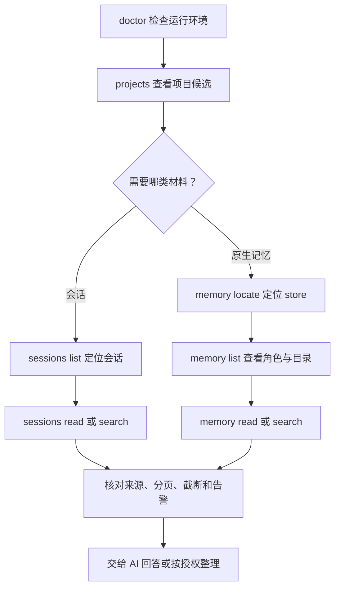
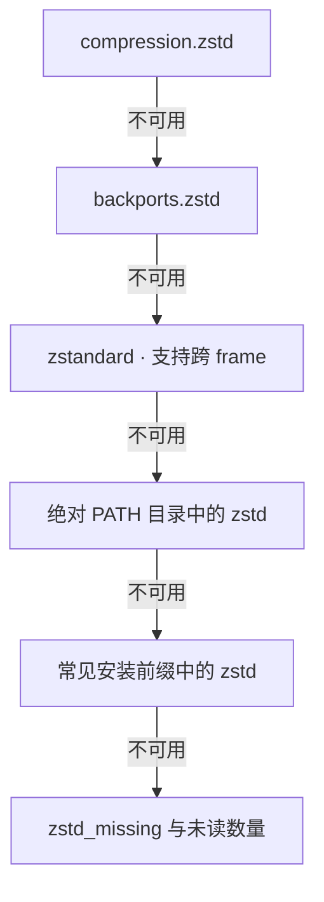

# Client Readers 0.2.1

只读地读取 Codex、Claude Code、ZCode、Qoder CN 和 WorkBuddy 留在本机的会话与原生记忆。每个客户端有一个技能及自包含 `scripts/read.py`，可独立用于历史查阅、工作接续或为 XMemory 提供来源。

## 命令与来源

| 命令 | 用途 |
|---|---|
| `projects` | 项目候选、会话数、记忆数、路径别名与父子关系 |
| `sessions list/read/search` | 定位会话，读取正文或按关键词检索 |
| `memory locate/list/read/search` | 定位原生记忆，按角色与归属读取文件 |
| `doctor` | 检查数据根、当前 Python 与已有 zstd 后端 |

| 客户端 | Skill | 会话来源 | 原生记忆位置 |
|---|---|---|---|
| Codex | [read-codex](skills/read-codex/SKILL.md) | rollout JSONL / JSONL.zst，原生状态索引辅助标题 | `~/.codex/memories/`、`memories_v2/`、`automations/<id>/memory.md` |
| Claude Code | [read-claude](skills/read-claude/SKILL.md) | 项目 JSONL、可选子代理记录 | `~/.claude/projects/<编码目录>/memory/` |
| ZCode | [read-zcode](skills/read-zcode/SKILL.md) | SQLite session / message / part | `~/.zcode/cli/memories/projects/<slug>-<hash16>/memory/` |
| Qoder CN | [read-qodercn](skills/read-qodercn/SKILL.md) | 项目 JSONL、桌面 main.sqlite | `~/.qoder-cn/projects/<编码>/memory/`、`memory/`、`memories/<用户ID>/projects/<编码>/<分类>/` 及旧 global 分类 |
| WorkBuddy | [read-workbuddy](skills/read-workbuddy/SKILL.md) | 项目 JSONL 的 message 与工具事件 | `<cwd>/.workbuddy/memory/`、`~/.workbuddy/MEMORY.md`、`memory/`、`user-*/` |

路径简写相对同一行的客户端根。各 Skill 内的 `references/sessions.md` 与 `references/memory.md` 列出实际布局和归属规则。Qoder CN 旧 IDE 专有数据库未适配。

`memory`、`projects`、`doctor` 使用当前用户主目录下的默认客户端数据根，没有 `--root`，也不读取 `CODEX_HOME` 或 `CLAUDE_CONFIG_DIR`。异地会话原件用 `sessions --root PATH` 选择；WorkBuddy 工作区记忆可按会话 cwd 或 `--project` 发现。

## 安装

需要用户自己的 Python 3.9+，普通读取使用标准库。插件与 XMemory 一起列在 `xmemory-marketplace`，可以单独安装 `client-readers@xmemory-marketplace`。完整市场包及迁移步骤见[安装说明](https://github.com/BlueSkyXN/XMemory/blob/main/docs/release-install.md)。

独立技能包为 `ClientReaders-0.2.1-skills.zip`。按需复制完整的 `read-<client>/` 目录，保留脚本与参考文件；无需统一 CLI、PATH 配置、MCP 或后台服务。

从 Conversation Readers 升级时，通过宿主移除旧 `conversation-readers` 插件并保留需要的数据，再安装本插件。独立技能安装需处理旧的五个 `read-*-conversations` 目录。同一客户端避免同时启用插件和同名独立技能。

## 最短读取路径



以下示例使用 Codex 脚本，其他客户端替换 Skill 目录即可。路径、会话引用和偏移均须来自实际结果。示例采用 Bash / Zsh；其他 shell 可直接把脚本绝对路径写在 `python3` 后。

```bash
reader_script="/absolute/path/to/client-readers/skills/read-codex/scripts/read.py"
python3 -B "$reader_script" --help
python3 -B "$reader_script" doctor
python3 -B "$reader_script" projects --limit 40
```

项目总览的 `parent` / `children` 在筛选与分页前计算；`aliases` 保留已确认的同 inode 路径。`projects --since` 过滤近期会话计数，有记忆的项目仍可显示，`memory_without_sessions` 按全部会话判断。项目候选由用户选择后再用于采集配置。

## 读取会话

先按项目或标题定位，也可以用 `--root` 指定已知目录、JSONL 或受支持的 SQLite：

```bash
python3 -B "$reader_script" sessions list --project "/absolute/path/to/Maple" --limit 40
python3 -B "$reader_script" sessions list --query "导出"
python3 -B "$reader_script" sessions list --root "/absolute/path/to/rollout.jsonl"
```

`list --query` 匹配标题或 ID，正文检索使用 `search`。把 `SESSION_REF` 替换为列表返回的完整 `session_ref`：

```bash
python3 -B "$reader_script" sessions read --session "SESSION_REF" --limit 40
python3 -B "$reader_script" sessions search --session "SESSION_REF" --query "回滚"
python3 -B "$reader_script" sessions read --session "SESSION_REF" --include-tools --format markdown
```

异地来源的后续调用继续携带同样的 `--root`。需要工具执行结果时加 `--include-tools`；目录型子代理来源可用 `--include-subagents` 纳入。隐藏推理不进入输出。

按北京时间查询某一天时，显式写出时区与含边界的结束时刻；以下日期为示例：

```bash
python3 -B "$reader_script" sessions list --project "/absolute/path/to/Maple" --since "2026-10-16T00:00:00+08:00" --until "2026-10-16T23:59:59.999999+08:00"
```

无时区的时间按 UTC 解释。JSONL 的项目筛选选中包含该目录的会话，read/search 仍可返回同一会话的其他项目片段，归属要结合事件项目和正文核对。

## 读取原生记忆

`store` 是读取器发现的一处原生记忆存储目录。先定位，再按返回的 store 或项目列出文件：

```bash
python3 -B "$reader_script" memory locate --limit 40
python3 -B "$reader_script" memory list --store "/absolute/path/to/store" --outline
python3 -B "$reader_script" memory list --project "/absolute/path/to/Maple" --role topic session_summary
```

`--store` 与 `--project` 互斥。`memory list` 至少指定其中一个；`memory read` 使用已知 store 内的实际文件路径：

```bash
python3 -B "$reader_script" memory read --path "/absolute/path/to/store/topic.md" --max-chars 6000
python3 -B "$reader_script" memory read --path "/absolute/path/to/store/topic.md" --section 0
python3 -B "$reader_script" memory search --store "/absolute/path/to/store" --query "回滚"
```

常用角色包括 `index`、`topic`、`session_summary`、`profile`、`activity`。索引用于导航，实际内容按文件角色读取；备份默认只列元数据，显式 `--include-backups` 才读取正文。

`duplicate_of` 标注同客户端字节相同的文件，`same_session_as` 标注同一原生会话的摘要，`migrated` 标注迁移状态。读取器保留各文件，AI 根据正文差异决定如何整理和计证。`orphan`、`ambiguous` 或 `project=null` 保留未定归属，`near` 只提供查找线索。

## 分页与覆盖怎么读

| 情况 | 返回字段 | 后续操作 |
|---|---|---|
| 列表、检索或总览还有下一页 | `has_more`、`next_offset` | 原条件不变，将返回值传给 `--offset` |
| 会话某条正文被截断 | `truncated`、`record_ref`、`next_text_offset` | 用 `sessions read --record` 定位，再以 `--text-offset` 展开；工具记录保留 `--include-tools` |
| 记忆正文尚未读完 | `next_text_offset` | 同一 `--path` 改用 `--text-offset`；限定章节时还需遵守 `section_end` |
| JSONL 活文件变化 | 首次 `snapshot` 映射、变化错误 | 后续 read 传该会话对应的 `--snapshot`；发生变化后重新定位 |
| 记忆文件读取中变化 | `sha256`、`source_changed_during_read` | 重新列出并核对版本，避免拼接不同版本的正文 |
| 结果中存在读取缺口 | `coverage`、`warnings` | 按具体来源、格式或上限处理，保留未读范围 |
| 已扫描告警未在本页返回 | `warnings_outside_filter` | 结合筛选和分页定位范围外告警 |

默认每页 40 项、最多 200 项；正文默认每块 6,000 字符、单次最多 100,000。`sessions --max-sessions` 默认最多检查 200 个候选会话，达到上限报告 `session_scan_limit`；优先缩小 `--root` 范围。

正文先遮蔽，再检索和切片，字符偏移基于遮蔽后的文本。会话 `--text-offset` 要与 `--record` 配合；记忆 `--section` 和 `--text-offset` 互斥。章节截断后按返回的 `next_text_offset` 继续，并将 `--max-chars` 限在 `section_end - next_text_offset` 内。

`coverage.scan_complete` 结合扫描缺口和结果分页判断，长文本还需检查各条截断字段。SQLite 只保证单次只读事务内一致，跨请求仍为活数据，无法使用 JSONL 的 `--snapshot` 冻结。

| 输出 | schema |
|---|---|
| 会话 | `conversation-readers/v1`，为兼容保留历史名称 |
| 原生记忆 | `client-readers/memory-v1` |
| 项目总览 | `client-readers/projects-v1` |
| 运行自检 | `client-readers/doctor-v1` |

默认输出 JSON，读取类命令可加 `--format markdown`；两种形式都遵守分页与截断。关键词搜索为不区分大小写的字面匹配。完整定义见[会话输出契约](skills/read-codex/references/output-sessions.md)与[原生记忆输出契约](skills/read-codex/references/output-memory.md)，五个技能随包携带同一份公共契约。

## 运行环境与自检

```bash
python3 -B "$reader_script" doctor
# 需要了解已有解释器时再执行；仅探测，不切换环境
python3 -B "$reader_script" doctor --candidates
```

`doctor` 报告当前解释器、数据根和已有后端；`--candidates` 额外启动已找到的解释器做限时探测。脚本不安装依赖或自动换解释器。调用方可使用用户指定的 `CLIENT_READERS_PYTHON`；XMemory 的对应选择为 `XMEMORY_PYTHON`。

Codex 压缩会话按下列顺序使用已有能力：



已有 Python 后端时，普通命令省去外部探测；`doctor` 仍列出全部可用后端。缺失时根据自检选择已有 Python 或由用户决定安装后端。脚本输出统一为 UTF-8，支持 `python3 -I -B` 隔离调用。

## 常见问题与数据范围

| 现象 | 核对方法 |
|---|---|
| 数据存在但 locate 没找到 | 核对默认客户端根和实际布局；memory 命令不跟随自定义客户端环境变量 |
| `list_requires_store_or_project` | 为 `memory list` 指定实际返回的 `--store` 或项目路径 |
| `not_in_store` | 从 locate/list 返回的路径读取，检查是否越界或链接到 store 外 |
| `memory_read_error`、`frontmatter_partial` | 按文件定位核对权限、内容和未支持的元数据形状，保留读取缺口 |
| `snapshot_changed_or_unsupported` | 重新定位变化的 JSONL；SQLite 不使用此参数 |
| `zstd_missing` | 运行 doctor，选择已有后端或明确安装需要的能力 |
| 空结果 | 同时看 `coverage.content_status`、告警与筛选范围；区分无命中、格式不支持和未读全 |

程序只读本机，不联网、不调用模型、不写记忆库。常见凭据会遮蔽，输出仍属于用户私有资料；保存或分享前按内容检查。来源中的历史命令仅作材料。

## 维护与验证

仓库的 `tools/client_readers/` 是公共实现及契约维护源，`tools/sync_client_readers.py --apply` 同步五份自包含脚本和两份输出契约。修改维护源后再同步；每个 Skill 独立运行，无运行期跨目录依赖。

在源码仓库根执行检查与构建，输出目录选择尚无同名归档的位置：

```bash
python3 -B tools/build_client_readers.py --check
python3 -B -m unittest tests.test_client_readers tests.test_client_memory tests.test_client_runtime -v
python3 -B tools/build_client_readers.py --output dist/readers-check
```

构建生成本地归档与 SHA256，不安装或发布插件。已有程序、CI 与行为验收的证据范围见[验证记录](docs/validation.md)。许可证：[GNU GPL v3](LICENSE)。
