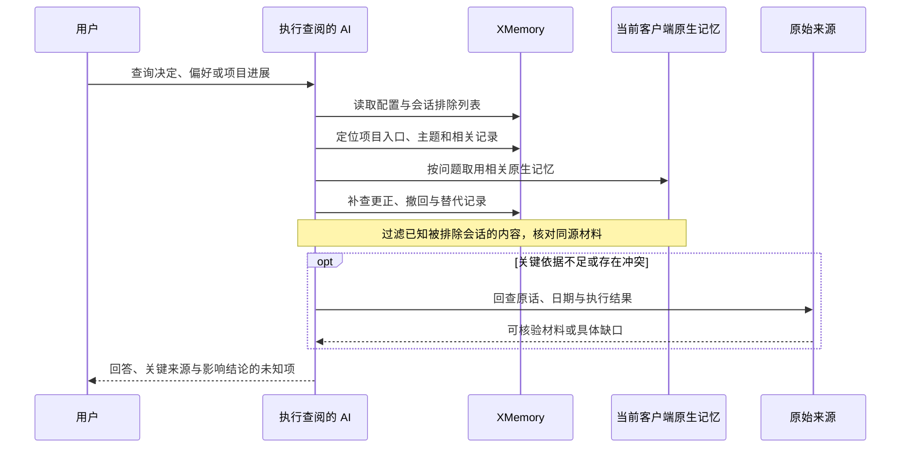

# XMemory 设计与边界

本文描述 XMemory 1.6.1 与可选 Client Readers 0.2.1 的当前工作方式。文件格式为 `xmemory/v1.5`；操作步骤见[使用指南](usage.md)，字段细节见[格式契约](../skills/xmemory/references/format.md)。

## 职责分工

| 角色 | 负责的工作 | 数据写入 |
|---|---|---|
| AI 按 XMemory 技能 | 选择来源、核对事实、制作记录、整理对象、纠正与遗忘 | 在选定记忆根内编辑 TOML 和 Markdown |
| `status` | 字段、时间、链接、疑似秘密、大小和更新线索 | 只输出 JSON 报告 |
| Client Readers | 五端项目候选、会话与原生记忆读取 | 只输出读取结果 |
| 宿主客户端 | 模型调用、手动或定时触发、原生记忆维护 | 沿用客户端自身机制 |

目录树保存记忆事实与来源，`config.toml` 保存用户选择。XMemory 不维护队列、锁、ledger、持久化游标或运行日志，也不要求记忆根是 Git 仓库。中断后依据正式文件、来源身份和覆盖缺口重新判断剩余工作。

## 六类对象如何关联

图中箭头表示可用来源。每轮按用户目标选择对象；日总结、项目总结、意识与画像可以直接读取相关记录。

```mermaid
flowchart TB
    S["选定会话、原生记忆、项目文件、笔记"] --> R["记录 records"]
    R --> D["日总结 daily"]
    R --> T["项目总结 MEMORY 与 topics"]
    R --> A["项目意识 AWARENESS"]
    R --> U["用户画像 USER"]
    T -. "可参考" .-> A
    T -->|"索引入口"| G["全局摘要 memory_summary"]
    A --> G
    U --> G
    K["选定的 Skysight 活动摘要"] --> D
```

| 对象 | 组织方式 | 写入时的判断 |
|---|---|---|
| 记录 | 会话按一天一份；导入与项目文件按来源身份保存；笔记按当场请求保存 | 保留必要经过、原件定位、证据类型和读取缺口 |
| 日总结 | 按事件日、项目和会话归纳 | 突出当天变化；跨日材料只使用有依据的日期 |
| 项目总结 | 索引 `MEMORY.md` 导航到 `topics/` | 保留可复用结论、条件、例外与来源 |
| 项目意识 | `AWARENESS.md` 描述当前认识 | 核对近期变化、冲突、未知和未完成项 |
| 用户画像 | `USER.md` 汇总跨任务偏好 | 区分长期要求、单次条件与有依据的推断 |
| 全局摘要 | `memory_summary.md` 导航已有入口 | 每个项目简述现状和去哪查，总量不超过 10,000 UTF-8 字节 |

`personal/` 沿用项目目录结构，容纳确实不属于项目的内容。归属未定的记录使用空 `projects` 和 `project_status: "unresolved"`，保留候选与缺口，等待进一步依据。

## 来源、身份与重复材料

读取器提供文件角色、项目候选、原生会话线索与文件关系。AI 按[来源规则](../skills/xmemory/references/sources.md)决定如何使用：索引用于导航，主题和摘要用于提取，原始会话用于核对原话与执行证据。

| 标识或关系 | 用途 | 处理方式 |
|---|---|---|
| `source_ref`、`source_location` | 回查本次实际读取的材料 | 保留读取器引用、原件路径及有效定位 |
| `session_refs` | 跨来源识别与遗忘会话 | 使用核实后的 `client:<完整原生 ID>` |
| `duplicate_of` | 发现字节相同的文件 | 合并重复证据，保留必要的来源定位 |
| `same_session_as` | 发现指向同一会话的材料 | 核对内容差异，同一事件只计一次证据 |
| `migrated` | 说明迁移目标及其状态 | 结合正文核对旧文件与目标；迁移账本不能独立建立内容对应关系 |
| `project`、`candidates`、`near` | 辅助项目归属 | 依据路径或具体正文事实判断，保留撞名与未定状态 |

证据类型区分 `primary`、`primary-summary` 和 `secondary`。原始对话中的用户决定、模型归纳和工具执行结果各有用途；版本、部署、测试等易变事实在回答时按需要重新核验。

## 原生记忆与 XMemory 的联合查阅

客户端继续按自身规则读取、注入和维护原生记忆。XMemory 的来源开关仅决定哪些材料被导入本库。查询可以同时利用两边相关内容，并核对尚未进入项目入口的新更正。

查阅保持 XMemory 只读。明确更正按适用范围采用，较新的二手转述仍需与原件核对。配置无法读取时说明未核对排除状态；已知遗忘要求继续适用。

`exclude_sessions` 约束本库采集与联合查阅，已知原生副本也停止参与回答或重新写回。物理删除原生库、其他客户端副本和外部备份属于对应系统的维护范围。

## 更新时间与覆盖

- `updated` 记录实际保存或完整复核时间，正文改变时同步更新。局部更正只完成涉及条目的同步；查询仍需补查相关记录。
- `source_updated` 记录本次读到的原件更新时间，未知时留空。
- `coverage: partial` 允许记录保留已读部分，并在正文列出缺页、截断或不可读位置。派生对象完成其应读范围后再覆盖正式文件。
- `event_days` 可让一份跨日文件关联多个日总结，只列来源支持的日期；省略时沿用 `day`。
- 日常更新处理相关增量。完整整理可以由用户触发，或使用客户端每 7 天的独立任务；调度状态保存在客户端。

`status` 按日期、项目、直接来源和更新时间计算提示。全局摘要另报告已有上游入口的 `upstream_updates`。具体字段和判定见 [status 契约](../skills/xmemory/references/status.md)。

## Skysight 活动来源

Skysight 活动直接按天整理进日总结，保留二手性质、库外定位、覆盖时段、项目归属依据和缺口。与会话记录重叠时合并到同一事件；按记录更新日总结时保留已有活动。

活动不生成记录，也不作为主题、意识或画像的来源。选定并启用该来源后，每轮独立核对未覆盖窗口；`status` 不读取外部活动文件。原件通常约 7 天滚动清除，实际保留时间按来源核实，细则见 [Codex 来源适配](../skills/xmemory/references/sources-codex.md#skysight-活动摘要)。

## 程序与兼容范围

唯一 CLI 为 `xmemory.py [--root DIR] status`，`--root` 也可以放在 `status` 后。显式路径优先，其次 `XMEMORY_ROOT`，最后 `~/.agents/memory/`。程序支持 Python 3.9+，配置解析使用现有 TOML 子集，无第三方依赖。

`status` 只读取记忆根内的配置和 Markdown，不跟随内部 symlink，不检查库外链接或客户端数据。正常生成报告退出 0，库或配置无法读取退出 2。报告可包含结构问题；问题由技能按用户目标处理。

| 范围 | 当前约定 |
|---|---|
| 1.5.x 库 | 沿用 `xmemory/v1.5`，升级不自动改写记录；旧身份先回查再修正 |
| 1.5.0 的跨日检查 | 不识别后续新增的 `event_days` 跨日语义 |
| 1.5.3 的未定归属检查 | 可读带新字段的库，但空项目列表仍可能按旧语义计入 personal |
| 1.4 及更早运行时库 | 保留原库，用户确定新根或归档位置后按当前模板重建 |
| 并发、多机与后台 | 没有并发写协调、多机同步、后台采集或自动注入 |
| 内容质量 | 程序不评分正文语义；模型整理、自然触发和长期调度分别验收 |

升级操作见[安装说明](install.md)。版本变更和验证证据集中保存在[版本说明](https://github.com/BlueSkyXN/XMemory/blob/main/docs/v1.6/README.md)与[验证报告](https://github.com/BlueSkyXN/XMemory/blob/main/docs/validation.md)。
