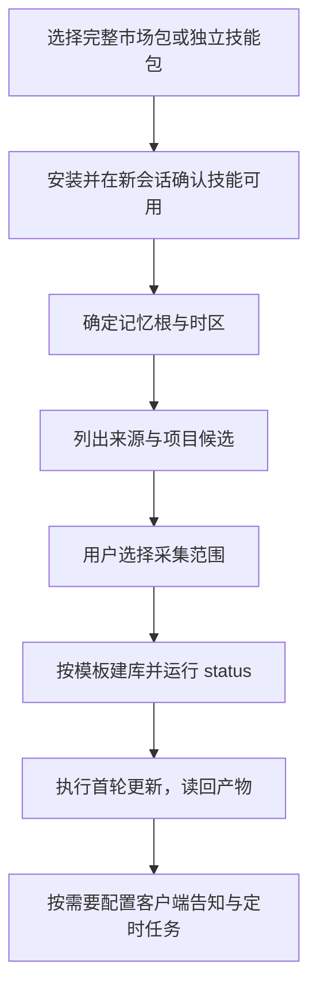

# 安装与首次使用

当前版本为 XMemory **1.7.0**、可选 Client Readers **0.2.1**，记忆格式为 `xmemory/v1.5`。正式附件见 [v1.7.0 Release](https://github.com/BlueSkyXN/XMemory/releases/tag/v1.7.0)。

## 运行前准备

| 条件 | 要求 |
|---|---|
| 宿主 | 能发现并执行技能，能读取选定来源、编辑记忆目录 |
| Python | 安装后的程序需要 Python 3.9+；开发工具需要 3.11+ |
| 记忆根 | 默认 `~/.agents/memory/`，也可指定其他集中目录 |
| Client Readers | 可选，读取五端会话、原生记忆和项目候选时使用 |
| Codex 压缩会话 | `.jsonl.zst` 需要已有 zstd 后端，可先运行读取器 `doctor` |

XMemory 的 `status` 与普通读取使用标准库。安装插件提供技能和脚本，建库、启用来源及配置定时任务在后续步骤完成。



## 市场安装

下载 `XMemory-1.7.0.zip`，按同名 `.zip.sha256` 校验后解压完整目录。使用源码目录时采用同样的市场根：

| 客户端 | 市场根 | 插件 ID |
|---|---|---|
| ZCode | 源码或完整包的 `plugins/` | `xmemory@xmemory-marketplace` |
| Claude Code | 源码或完整包根 | `xmemory@xmemory-marketplace` |
| Codex | 源码或完整包根 | `xmemory@xmemory-marketplace` |

市场还包含 `client-readers@xmemory-marketplace`，两个插件分别安装。以下路径替换为实际解压根；只执行目标客户端的命令。

Claude Code：

```bash
claude plugin marketplace add /absolute/path/to/XMemory-1.7.0
claude plugin install xmemory@xmemory-marketplace
```

Codex：

```bash
codex plugin marketplace add /absolute/path/to/XMemory-1.7.0
codex plugin add xmemory@xmemory-marketplace
```

ZCode 在插件市场添加 `plugins/` 的实际绝对路径并安装 XMemory。需要读取器时，在同一市场安装 Client Readers；Claude Code 使用 `claude plugin install client-readers@xmemory-marketplace`，Codex 使用 `codex plugin add client-readers@xmemory-marketplace`。

已注册同名市场时，先核对现有来源路径，通过客户端更新原安装。命令随宿主版本演进，执行前可用 `plugin --help` 和对应子命令的 `--help` 核对支持情况。

## 独立技能安装

- `XMemory-1.7.0-skills.zip`：将 `skills/` 下八个目录一起放进客户端支持的技能目录，保留相对位置。技能之间会互相引用。
- `ClientReaders-0.2.1-skills.zip`：按需要复制完整的 `read-<client>/` 目录，保留其中的 `scripts/` 与 `references/`。每个读取技能可以单独运行。

同一客户端选择插件安装或独立技能安装中的一种，避免同名入口同时启用。确认新会话可以发现八个 XMemory 技能，以及实际安装的读取技能。

## 从旧读取器升级

只有已安装 Conversation Readers 时才需要这一步。先记录旧插件 ID、启用状态及需保留的数据，再通过宿主卸载旧插件，随后安装 Client Readers。下例按当前市场名书写；旧市场安装应使用实际 ID。

```bash
# Claude Code：保留该插件的持久化数据目录
claude plugin uninstall conversation-readers@xmemory-marketplace --keep-data
```

```bash
# Codex：移除插件及其本地缓存；操作前保留缓存内自行添加的文件
codex plugin remove conversation-readers@xmemory-marketplace
```

ZCode 使用插件管理中的卸载功能。独立技能安装需在确认目标后移除旧的五个 `read-*-conversations` 目录，再放入新技能。XMemory 记忆根与客户端原始会话沿用已有位置。

## 旧市场名迁移

v1.5.3 及对应旧包使用 ZCode `xmemory`、Claude Code `xmemory-claude`、Codex `xmemory-codex`。市场名属于插件 ID，以实际包内清单的 `name` 为准。

1. 记录已安装插件、启用状态、配置、插件数据位置和实际记忆根。
2. 核对宿主卸载行为，保留需要的数据，再移除旧插件 ID 和旧市场注册。
3. 按上表添加新市场，只安装需要的插件，恢复相应启用状态与配置。
4. 在新会话确认新 ID 和技能可用，再处理残留的旧技能入口。记忆库无需因市场改名重建。

迁移通过客户端支持的流程执行，直接改缓存目录名无法同步安装登记。

## 首次设置

可以告诉代理：

> 设置 XMemory，记忆根使用我指定的集中目录，时区使用实际 IANA 时区。先列出来源与项目候选，等我选择后再创建配置和启用来源。

设置技能先查看已有目录；有旧内容时先确定复用、归档或新建范围。安装了 Client Readers 时，可以通过各端 `projects` 得到项目路径、别名、会话数、记忆数以及 `parent` / `children`，供用户选择。没有读取器时按[来源参考](../skills/xmemory/references/sources.md)只读定位。

配置从 [config.toml 模板](../skills/xmemory/templates/config.toml)填写，以下是仅列出项目文件来源的结构示例；路径和时区需替换为实际选择，启用前核对范围：

```toml
format = "xmemory/v1.5"
timezone = "Etc/UTC"
exclude_sessions = []

[sources.project_files]
enabled = false
kind = "files"
client = "filesystem"
paths = ["/absolute/path/to/Maple/README.md"]

[projects.Maple]
roots = ["/absolute/path/to/Maple"]
```

`paths` 列出具体文件或目录，`roots` 登记项目实际路径与已确认别名。记录日期按配置时区解释；项目匹配按路径边界取最具体的根。可选配置与全部字段见[格式契约](../skills/xmemory/references/format.md#配置)。

设置后运行只读检查，将脚本路径替换为实际安装位置：

```bash
python3 -B "/absolute/path/to/xmemory/skills/xmemory/scripts/xmemory.py" --root "/absolute/path/to/memory" status --summary
```

有效配置应能生成 `xmemory/status-v1.5` JSON，开头的 `inventory` 给出配置来源、登记项目、已有内容与候选数量。新库可能列出有直接输入、尚未创建的候选；按实际材料决定创建范围。再让代理完成一次选定来源的更新，并读回文件与来源链接，详见[使用指南](usage.md)。

## 现有记忆库升级

| 现有库 | 操作 |
|---|---|
| 1.5.x，格式 `xmemory/v1.5` | 沿用原目录和格式，升级技能；旧身份或归属问题在相关材料复查时处理 |
| 1.4 及更早运行时库 | 保留原库，确定新目录或归档位置后按当前模板重建，不能只替换配置中的格式名 |
| 已有 Skysight 记录或旧告知 | 按用户确定的历史范围整理；安装过程不转换已有内容、不创建定时任务 |

1.5.0 不理解后续的 `event_days` 跨日语义；1.5.3 可读取未定归属字段，但仍可能把空项目列表按 personal 处理。升级到当前版本后按新增提示核对来源，不自动改名或批量重写记录。

## 告知与定时

[客户端告知](../skills/xmemory/templates/agents-notice.md)按用户要求合并到指定规则文件，保留原生记忆的入口与维护机制。XMemory 的来源开关控制导入；联合查阅按 `exclude_sessions` 过滤已知被排除会话的材料。

[日常增量](../skills/xmemory/templates/automation-prompt.md)与[每 7 天完整整理](../skills/xmemory/templates/organization-prompt.md)使用独立提示词，由客户端调度。任务执行环境需要能读取来源和写入同一个记忆根；写入任务应错开。

首次使用的完成标志是：新会话发现技能、配置符合用户选择、`status` 可解析、一次选定范围的更新有可读产物及来源。客户端自然触发和持续调度的验证范围见[验证报告](https://github.com/BlueSkyXN/XMemory/blob/main/docs/validation.md)。
