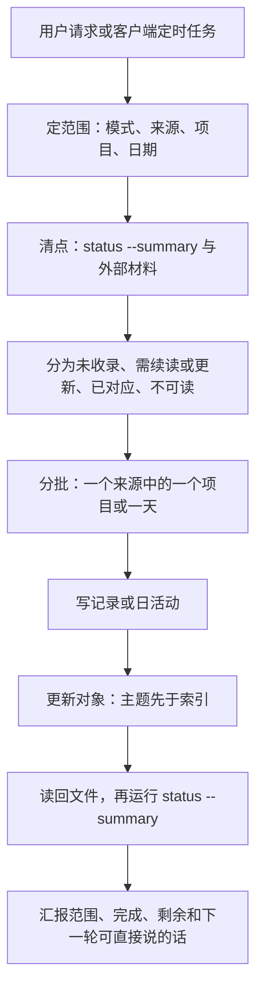

# XMemory 使用指南

本文面向已安装 XMemory 的用户。首次选择记忆根和来源见[安装说明](install.md)，精确字段见[格式契约](../skills/xmemory/references/format.md)。

## 按目标选择操作

| 目标 | 请求示例 | 主要产物 |
|---|---|---|
| 更新一轮 | “更新记忆，只处理 Maple 项目最近两天的选定来源。” | 新记录及本轮相关对象 |
| 补全遗漏 | “补全 Maple 的记忆，先做一批并报告各来源的剩余。” | 分批写入的记录与对象，以及按来源列出的剩余范围 |
| 查看现状 | “现在记忆什么情况，初始化好了没？” | 只读汇报配置、已有内容、候选与待处理数量 |
| 只整理已有材料 | “根据现有记录更新 Maple 意识，暂不读取外部来源。” | `projects/Maple/AWARENESS.md` |
| 按日期回顾 | “查昨天的工作，列出项目、结果、依据和未完成项。” | 只读回答，按需展开日总结与记录 |
| 接续项目 | “查 Maple 的当前决定和未完成项，核对后来的纠正。” | 当前判断及关键来源 |
| 当场记住 | “记住：Maple 的导出任务先核对清单，再做小样本验证。” | 一条笔记，按适用范围同步相关主题 |
| 修正偏好 | “记住这项更正：以后工作报告先给结论与依据，详细过程按需展开。” | 笔记及相关 `USER.md` 条目 |
| 完整整理 | “整理 Maple 的全部主题和相关记录，处理重复、过时与冲突。” | 主题与索引，其他对象按本轮需要更新 |
| 遗忘会话 | “遗忘 claude:example-session-01，保留其他来源独立支持的结论。” | 排除配置与相关内容清理 |

Maple、日期和会话 ID 都是示例，实际使用时替换为已登记项目及核实后的身份。只更新一个对象时，范围就限定在该对象及必要来源。

## 运行一轮如何完成



增量模式处理近期新材料和已有缺口；补全模式在已选范围内逐项核对来源身份、版本和覆盖，首批立即执行，到工作量限制时停在批次边界。记录可以保存已读部分并标记 `partial`。日文件和单个主题处理完全部待更新来源后再保存，否则保留原文件并报告待整理；项目索引可以随已完成的主题更新。

启用 Skysight 时，日常更新还会独立检查活动覆盖窗口。活动只进入日总结，即使本轮没有新记录，也需要检查选定窗口。

汇报固定四项：本轮范围及外部是否清点完整；新增和更新的记录与对象；各来源剩余数量或未知、partial 与不可读原因；下一轮可以直接说的一句话。清单只留在本轮上下文，下一轮从文件与原件重新核对。

## 查阅与纠正

查询先应用 `config.toml` 中的 `exclude_sessions`，再按问题取用当前客户端原生记忆和 XMemory：

- 接续项目：从全局入口定位项目，读取 `AWARENESS.md` 和相关记录。
- 查稳定做法：从 `MEMORY.md` 的“什么时候看”进入主题。
- 查某天工作：读取 `daily/<年>/<日期>.md`，按需回到来源记录。
- 查偏好与决定：补查相关笔记、会话、导入记录里的更正、撤回和替代。

入口可能晚于部分未吸收记录，查阅要按主题找更正。需要确认原话或实际测试结果时沿来源回查；配置、版本、部署等易变事实按需要核对当前状态。联合查阅的顺序与职责见[设计图](design.md#原生记忆与-xmemory-的联合查阅)。

明确要求记住一项长期偏好或项目决定时，笔记技能会保存来源，并同步涉及的画像或主题；用户只要记录时按该范围执行。查阅本身保持 XMemory 只读，发现旧入口尚未同步会在回答中说明。

## 读懂 status

把脚本路径替换为实际插件目录，记忆根替换为已配置的位置：

```bash
python3 -B "/absolute/path/to/xmemory/skills/xmemory/scripts/xmemory.py" --root "/absolute/path/to/memory" status --summary
```

输出为 JSON，`schema` 是 `xmemory/status-v1.5`。退出码 0 表示生成了报告，报告仍可能包含待处理项；退出码 2 表示库或配置无法读取。`--summary` 只列需要检查的对象，每条一行；去掉它查看完整对象列表。

| 字段 | 怎么使用 |
|---|---|
| `inventory` | 先读这里：配置来源与启用数、登记项目与有记录的项目、已有记录与派生对象、候选，以及 unknown 记录、未链接记录和派生对象的状态分布 |
| `objects` | 查看每个对象的 `assessment`、`reasons`、`newer_sources` 与 `unlinked_sources` |
| `upstream_updates` | 在 summary 对象中查看画像、意识或索引尚待处理的新来源 |
| `source_hints` | 查看已保存记录的来源时间、记录时间与 partial 数，外部来源另行检查 |
| `issues` | 按问题代码、库内路径和可用行号定位 |
| `counts` | 汇总本次对象判断和问题类型，便于更新前后对照；其中包含记录和候选，不能当作已有文件数或完成率分母 |
| `now` | 本次检查时间；保存文件时重新取得实际时间 |

| `assessment` | 含义与下一步 |
|---|---|
| `stale` | 存在较新的相关库内来源；读取这些来源后更新对应对象 |
| `review` | 需要语义复查或存在覆盖线索；先看 `reasons` 决定检查范围 |
| `missing` | 有直接输入的候选目标尚未创建；有实际内容时再建对象，登记项目本身不产生候选 |
| `current` | 按已有库内元数据未发现更新需求；查询仍核对相关更正与外部状态 |
| `unknown` | 元数据或读取情况不足以判断；先处理具体字段、时间或读取缺口 |

`status` 不扫描外部客户端，不自动修复文件。某来源记录数为零可能是尚未采集，也可能是直接进入日总结的 Skysight 活动；应结合配置与实际产物判断。

## 常见问题

| 现象或问题代码 | 处理方式 |
|---|---|
| 无库、配置不可读，退出 2 | 检查 `--root`、目录权限和 `config.toml`；首次使用按设置技能建库 |
| `missing_field`、`invalid_field`、`unsupported_format` | 对照格式与模板修正具体字段；旧 1.4 库按安装说明重建 |
| `invalid_time`、`future_time` | 核对 IANA 时区及带偏移的 ISO 时间，回查原件；历史时间未知就保留未知 |
| `partial_source`、`read_error` | 按定位补读缺页、截断或不可达来源；无法补证时保留缺口 |
| `broken_link` | 检查目标是否移动、改名或删除，修复相对链接并复核依赖结论 |
| `identity_review` | 回查完整原生会话身份，核对旧引用及文件名尾八位，再修正相关位置 |
| `unresolved_project` | 依据实际路径或明确正文事实判断归属；依据不足时继续保留未定 |
| `excluded_record` | 按维护技能核查目标记录及派生内容，清理仍在有效库内的排除会话内容 |
| `suspected_secret` | 核对文件与行号并移除确认的秘密值，报告只保留类型与位置 |
| `oversize` | 压缩重复表达，将细节放回主题或记录，保留条件和出处 |
| 意识文件 `limit_unset` | 当前未配置意识大小上限；按用户需要设置 `limits.awareness_max_bytes` |
| 读取器提示 `zstd_missing` | 使用读取器 `doctor` 检查已有后端；按需要选择运行环境，详见读取器说明 |
| 已安装却没有自动更新 | 检查新会话是否可用技能、来源是否启用，以及客户端是否实际配置并触发了任务 |

完整问题定义见 [status 契约](../skills/xmemory/references/status.md)。修复后读回文件并重新检查，不通过批量改时间消除未完成的来源核对。

## 遗忘与备份

遗忘会话先核实完整身份，再写入并读回 `exclude_sessions`，随后清理目标记录、派生内容与本库 `.xmemory/backups/` 中的副本。只有目标来源支持的内容才删除；其他独立依据支持的内容保留并更新引用。具体步骤见[维护技能](../skills/xmemory-maintain/SKILL.md)。

普通整理重写前，按技能只备份本次会改的文件，保留相对目录。遗忘时避免再生成含目标内容的新备份。客户端原始会话、原生记忆与外部备份的删除范围需分别处理。

## 告知与周期整理

[客户端告知模板](../skills/xmemory/templates/agents-notice.md)说明查阅入口、原生记忆共同使用与会话排除规则。按用户要求合并到指定客户端规则文件。

[日常增量模板](../skills/xmemory/templates/automation-prompt.md)用于选定范围的更新，[完整整理模板](../skills/xmemory/templates/organization-prompt.md)用于每 7 天复查主题、索引和相关记录。客户端负责调度与执行环境；同一记忆根的写入任务应错开。

安装、设置库、配置任务和实际运行是不同步骤。核对一次真实运行的来源、产物和报告后，再评估自然触发和持续调度。已有验证证据见[仓库验证报告](https://github.com/BlueSkyXN/XMemory/blob/main/docs/validation.md)。
